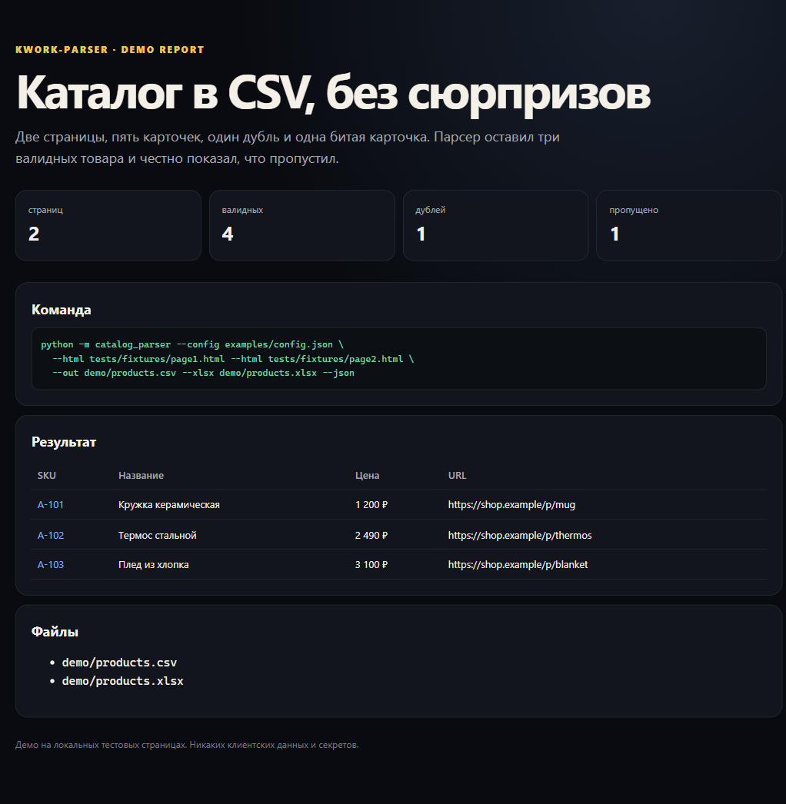

# kwork-parser

Небольшой парсер каталога: HTML или URL → CSV / XLSX по JSON-конфигу. Сделан как проверяемый пример для задачи «спарсить карточки товаров», а не как универсальный обходчик сайтов.



## Что работает

- парсинг локальных HTML-страниц и обычных URL;
- поля задаются селекторами в `examples/config.json`;
- склейка относительных ссылок с `base_url`;
- пагинация: несколько `--html` или `--url`;
- дедупликация по URL;
- пропуск карточек без обязательных полей;
- экспорт в CSV и XLSX;
- отчёт: страницы, найдено, дубли, пропущено.

## Быстрый старт

```bash
python -m pip install -r requirements.txt
python -m catalog_parser \
  --config examples/config.json \
  --html tests/fixtures/page1.html \
  --html tests/fixtures/page2.html \
  --out demo/products.csv \
  --xlsx demo/products.xlsx \
  --json
```

Разбор реальных страниц:

```bash
python -m catalog_parser \
  --config examples/config.json \
  --url "https://example.com/catalog?page=1" \
  --url "https://example.com/catalog?page=2" \
  --out products.csv
```

## Конфиг

```json
{
  "item": ".product",
  "base_url": "https://shop.example",
  "next": "a.next",
  "fields": {
    "title": {"selector": ".title", "required": true},
    "price": {"selector": ".price"},
    "url": {"selector": "a.link", "attr": "href", "required": true}
  }
}
```

`item` — карточка, `fields` — поля внутри карточки. Для ссылок и картинок укажите `attr`; иначе берётся текст элемента.

## Демо

```bash
python scripts/build_demo.py
```

Создаёт `demo/products.csv`, `demo/products.xlsx`, `demo/report.json` и `demo/index.html`.

## Тесты

```bash
python -m unittest discover -s tests -v
```

Проверяются парсинг, очистка пробелов, склейка URL, пагинация, дедупликация, пропуск битых карточек, CSV и XLSX.

## Ограничения

- Нужны корректные CSS-селекторы под конкретный сайт.
- Нет исполнения JavaScript; для SPA нужен браузерный рендер, это отдельная задача.
- Нет обхода CAPTCHA, авторизации, прокси и антибот-защит.
- Нет автоматического обхода всех страниц: URL пагинации передаются явно.
- Нет Google Sheets и CRM; это отдельные карточки.
- Перед парсингом клиент подтверждает, что источник и объём данных разрешены правилами сайта.

## Структура

```text
catalog_parser/   конфиг, извлечение, экспорт, CLI
examples/         пример конфига
tests/fixtures/   локальные страницы
scripts/          сборка демо
demo/             результат
docs/             архитектура и границы
```

## Лицензия

MIT.
